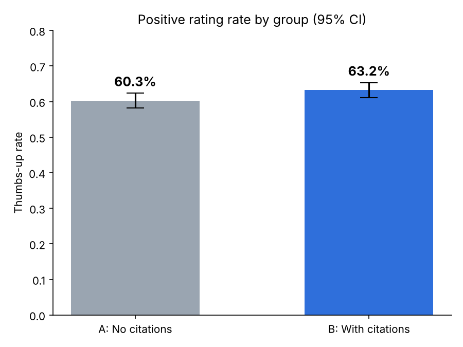

# هل عرض مصادر الإجابة في المساعد الذكي يرفع نسبة التقييم الإيجابي؟
### Do Citations in AI Assistant Answers Increase Positive Ratings? — An A/B Test

> 🎓 **المشروع الختامي لدورة "التجارب واختبارات A/B والاستدلال السببي" (A/B Testing and Causal Inference) المقدمة من [أكاديمية سدايا (SDAIA Academy)](https://github.com/SDAIAAcademy).**

| | |
|---|---|
| **إعداد** | رواف فهد النافع (Rawaf Al-Nafea) |
| **الدورة** | التجارب واختبارات A/B والاستدلال السببي |
| **الجهة المقدمة** | [أكاديمية سدايا](https://github.com/SDAIAAcademy) |
| **المنتج محل الدراسة** | مساعد ذكاء اصطناعي للإجابة عن الأسئلة مبني على RAG (منتج افتراضي) |
| **نوع البيانات** | محاكاة (Simulated) |

---

## 1. بيانات المشروع

**المشكلة:** مساعدات الذكاء الاصطناعي المبنية على RAG تسترجع مستندات ثم تولّد إجابة. المستخدم لا يرى من أين جاءت الإجابة، فقد يشكّ في صحتها ويقيّمها سلبيًا حتى لو كانت صحيحة.

**الهدف:** تقدير أثر عرض روابط المصادر أسفل الإجابة على رضا المستخدم.

**القرار المطلوب:** هل نطلق ميزة عرض المصادر لجميع المستخدمين أم لا؟

---

## 2. السؤال والفرضية

**السؤال الرئيسي:** هل عرض مصادر الإجابة (Citations) في المساعد الذكي يرفع نسبة التقييم الإيجابي (👍) للإجابات؟

**الفرضية:** إذا عُرضت روابط المصادر مع كل إجابة، فمن المتوقع أن **ترتفع** نسبة التقييم الإيجابي؛ **بسبب** زيادة ثقة المستخدم بالإجابة وقدرته على التحقق منها بنفسه.

| العنصر | التفاصيل |
|---|---|
| المعالجة (Treatment) | إضافة روابط المصادر أسفل الإجابة |
| المجموعة المعالجة B | ترى الإجابة مع المصادر |
| المجموعة المقارنة A | ترى الإجابة بدون مصادر (الوضع الحالي) |
| الأثر المتوقع واتجاهه | زيادة نسبة 👍 (اتجاه موجب) |

**الفرضيات الإحصائية:**
- **H₀:** لا يوجد فرق في نسبة التقييم الإيجابي بين A و B.
- **H₁:** يوجد فرق في نسبة التقييم الإيجابي بين A و B (اختبار ثنائي الطرف).

---

## 3. تصميم التجربة

| العنصر | التفاصيل |
|---|---|
| المجتمع المستهدف | المستخدمون الذين يطرحون سؤالًا على المساعد ويقيّمون الإجابة |
| نوع الدراسة | تجربة A/B عشوائية (التوزيع العشوائي ممكن لأن الميزة رقمية ونتحكم بها) |
| وحدة العشوائية | المستخدم (وليس الجلسة) حتى لا يرى المستخدم النسختين |
| نسبة التوزيع | 50% A / 50% B |
| طريقة التوزيع | توزيع عشوائي ثابت لكل مستخدم عند أول زيارة (في التطبيق الحقيقي: hash لمعرّف المستخدم) |
| المدة | 14 يومًا (أسبوعان كاملان) |

---

## 4. المقاييس

| النوع | المقياس | التعريف |
|---|---|---|
| **الرئيسي (Primary)** | نسبة التقييم الإيجابي | عدد 👍 ÷ عدد المستخدمين الذين قيّموا |
| **الحماية (Guardrail)** | زمن ظهور الإجابة (ms) | يجب ألا يزيد بأكثر من 10% عن المجموعة A |

اخترنا زمن الإجابة كمقياس حماية لأن استرجاع المصادر وعرضها قد يبطئ الإجابة، وهذا يضر تجربة المستخدم حتى لو ارتفع التقييم.

---

## 5. حجم العينة والمدة (`day2_sample_size.py`)

| المعامل | القيمة |
|---|---|
| مستوى الدلالة α | 0.05 (ثنائي الطرف) |
| القوة الإحصائية | 80% |
| النسبة الحالية (Baseline) | 60% |
| أصغر أثر قابل للاكتشاف (MDE) | +5 نقاط مئوية (60% ← 65%) |
| **حجم العينة المطلوب** | **1,471 مستخدم لكل مجموعة (2,942 إجمالًا)** |
| المستخدمون المتوقعون يوميًا | 300 |
| المدة المحسوبة | 10 أيام ← **مقرّبة إلى 14 يومًا** |

**طريقة الحساب:** معادلة حجم العينة لاختبار الفرق بين نسبتين:

n = [ z₁₋α/₂ · √(2p̄(1−p̄)) + z₁₋β · √(p₁(1−p₁) + p₂(1−p₂)) ]² ÷ (p₂ − p₁)²

قرّبنا المدة إلى أسبوعين كاملين لتغطية اختلاف السلوك بين أيام الأسبوع ونهايته، ولتجنّب إيقاف التجربة مبكرًا عند رؤية نتيجة (Peeking).

---

## 6. البيانات وفحوص الجودة (`day3_analysis.py`)

**مصدر البيانات:** البيانات **محاكاة** بـ Python (seed = 42 لضمان تكرار النتائج)، لعدم توفر بيانات حقيقية لهذه الميزة.

**افتراضات المحاكاة:**
- عدد المستخدمين يوميًا يتبع توزيع Poisson بمتوسط 300.
- كل مستخدم يُوزَّع عشوائيًا على A أو B باحتمال 50%.
- احتمال 👍 الحقيقي: 60% في A و 65% في B.
- زمن الإجابة يتبع توزيعًا طبيعيًا: 1,800ms في A و 1,850ms في B (انحراف معياري 400ms).

**ملف البيانات:** `data/experiment_data.csv`

| العمود | الوصف |
|---|---|
| `user_id` | معرّف المستخدم |
| `date` | تاريخ التقييم |
| `group` | A أو B |
| `thumbs_up` | 1 = 👍 ، 0 = 👎 |
| `latency_ms` | زمن ظهور الإجابة بالمللي ثانية |

**فحوص الجودة:**
| الفحص | النتيجة |
|---|---|
| القيم المفقودة | 0 ✅ |
| السجلات المكررة | 0 ✅ |
| مستخدمون ظهروا في المجموعتين | 0 ✅ |
| قيم غير صحيحة في المقياس (غير 0/1) | 0 ✅ |
| اختلال نسبة التوزيع (SRM) — Chi-square | p = 0.135 ✅ لا يوجد اختلال |

---

## 7. خطة التحليل (محددة قبل رؤية النتائج)

1. **فحص SRM** باختبار Chi-square: للتأكد أن التوزيع العشوائي عمل كما خُطط له.
2. **اختبار Z لنسبتين (Two-proportion z-test):** لأن المقياس الرئيسي ثنائي (👍/👎) والعينة كبيرة.
3. **فترة ثقة 95% للفرق المطلق** والتحسن النسبي (Relative Lift): لمعرفة حجم الأثر وليس فقط وجوده.
4. **Welch t-test لمقياس الحماية:** لأن زمن الإجابة متغير متصل، ولا نفترض تساوي التباين.
5. **قاعدة القرار:** نُطلق الميزة إذا كان p < 0.05 **و** نجح مقياس الحماية **و** لا يوجد SRM.

---

## 8. النتائج وتفسيرها (`day4_report.py`)

| المقياس | A (بدون مصادر) | B (مع مصادر) |
|---|---|---|
| عدد المستخدمين | 2,150 | 2,053 |
| عدد 👍 | 1,296 | 1,298 |
| **نسبة التقييم الإيجابي** | **60.28%** | **63.22%** |
| متوسط زمن الإجابة | 1,797 ms | 1,852 ms |

| الإحصائية | القيمة |
|---|---|
| الفرق المطلق (الأثر المقدر) | **+2.95 نقطة مئوية** (اتجاه موجب) |
| فترة الثقة 95% | من +0.01 إلى +5.88 نقطة |
| التحسن النسبي | +4.9% |
| Z / p-value | 1.96 / **0.0496** |
| مقياس الحماية (الزمن) | +3.1% (أقل من حد 10%) ✅ |



**الأهمية الإحصائية:** p = 0.0496 < 0.05، فنرفض H₀. عرض المصادر رفع نسبة التقييم الإيجابي بشكل دال إحصائيًا.

**الأهمية التجارية:** زيادة ~3 نقاط تعني أن من كل 1,000 إجابة مقيَّمة، حوالي 30 إجابة إضافية تحصل على 👍، وهذا مؤشر على ثقة أعلى بالمنتج. التكلفة بسيطة لأن المصادر موجودة أصلًا في نظام RAG، ونحتاج فقط عرضها.

**لكن يجب الحذر:**
- الـ p-value قريبة جدًا من 0.05، والحد الأدنى لفترة الثقة قريب من الصفر، فالأثر الحقيقي قد يكون صغيرًا جدًا.
- الفرق المرصود (+2.95) أقل من الـ MDE الذي صُممت التجربة لاكتشافه (+5).

---

## 9. التوصية النهائية

### ✅ القرار: إطلاق الميزة تدريجيًا (Gradual Rollout)

**المبررات:**
- الأثر موجب ودال إحصائيًا.
- مقياس الحماية سليم (زيادة الزمن 3.1% فقط).
- لا توجد مشاكل في جودة البيانات أو التوزيع.
- تكلفة الميزة منخفضة.

**لماذا تدريجيًا وليس كاملًا؟** لأن الأثر صغير وفترة الثقة تلامس الصفر. نقترح إطلاقها لـ 50% ثم 100% مع مراقبة نسبة التقييم وزمن الإجابة، أو إعادة التجربة بعينة أكبر لتقدير حجم الأثر بدقة أعلى.

---

## القيود والافتراضات

- **البيانات محاكاة** وليست من مستخدمين حقيقيين، فالنتائج توضح المنهجية ولا تُعمَّم على منتج حقيقي.
- **التقييم اختياري:** المستخدمون الذين يقيّمون قد لا يمثلون جميع المستخدمين (Selection Bias).
- **أثر الجِدّة (Novelty Effect):** المستخدم قد يتفاعل مع الميزة لأنها جديدة فقط، ويقل الأثر مع الوقت.
- لم نحلل الأثر حسب شرائح المستخدمين (مثل نوع السؤال أو لغته).

---

## طريقة التشغيل

```bash
git clone <رابط المستودع>
cd <اسم المستودع>
pip install -r requirements.txt
python main.py
```

أو تشغيل كل يوم على حدة بالترتيب:
```bash
python day1_design.py        # 1. السؤال والتصميم والفرضيات
python day2_sample_size.py   # 2. حجم العينة والمدة
python day3_analysis.py      # 3. توليد البيانات + فحوص الجودة + SRM + z-test + guardrail
python day4_report.py        # 4. الرسم البياني + التقرير والقرار
```

## هيكل المستودع
```
├── README.md
├── main.py                   # يشغّل جميع الخطوات بالترتيب
├── requirements.txt
├── day1_design.py            # إعدادات التجربة والفرضيات
├── day2_sample_size.py       # حجم العينة والمدة
├── day3_analysis.py          # المحاكاة، فحوص الجودة، والاختبارات الإحصائية
├── day4_report.py            # الرسم والتقرير والتوصية
├── data/
│   └── experiment_data.csv
└── outputs/
    ├── charts/
    │   └── thumbs_up_rate.png
    └── results/
        ├── results.json
        └── results.md
```

---

## شكر وتقدير
شكرًا لـ [أكاديمية سدايا (SDAIA Academy)](https://github.com/SDAIAAcademy) على تقديم دورة **"التجارب واختبارات A/B والاستدلال السببي"**، والتي تم تنفيذ هذا المشروع ضمنها.
