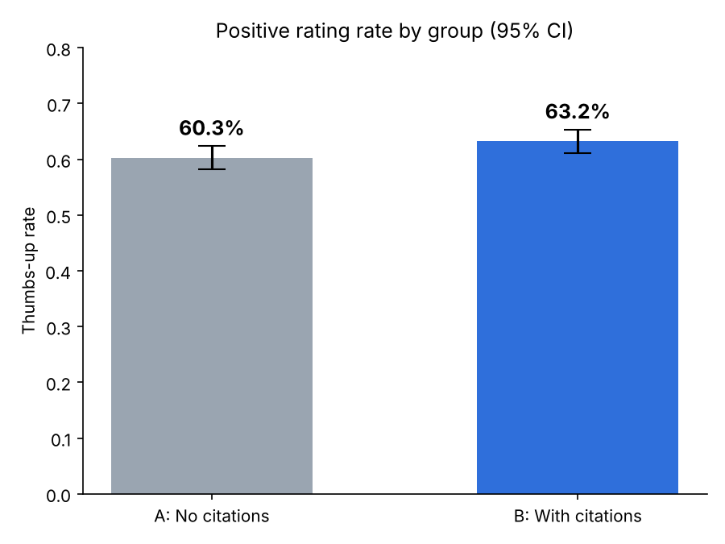

# تجربة A/B: هل عرض مصادر الإجابة في المساعد الذكي يرفع نسبة التقييم الإيجابي؟

> **ملاحظة:** البيانات في هذا المشروع **محاكاة** (Simulated) بافتراضات واقعية، والهدف تطبيق منهجية التجارب واختبارات A/B من البداية إلى النهاية.

---

## 1. السؤال والتصميم (الأحد)

**السؤال:** هل عرض مصادر الإجابة (Citations) في المساعد الذكي يرفع نسبة التقييم الإيجابي (👍) للإجابات؟

**الخلفية:** مساعدات الذكاء الاصطناعي المبنية على RAG تسترجع مستندات ثم تولّد الإجابة. عرض المصادر قد يزيد ثقة المستخدم بالإجابة، لكنه قد يضيف تأخيرًا بسيطًا في ظهورها.

| العنصر | التفاصيل |
|---|---|
| المجموعة A (Control) | إجابة بدون مصادر |
| المجموعة B (Treatment) | نفس الإجابة مع روابط المصادر |
| وحدة التوزيع العشوائي | المستخدم (50% / 50%) حتى لا يرى المستخدم النسختين |
| المقياس الأساسي | نسبة التقييم الإيجابي = عدد 👍 ÷ عدد الإجابات المقيَّمة |
| مقياس الحماية (Guardrail) | زمن ظهور الإجابة (ms)، والحد المقبول زيادة لا تتجاوز 10% |

**الفرضيات:**
- **H₀:** لا يوجد فرق في نسبة التقييم الإيجابي بين A و B.
- **H₁:** يوجد فرق في نسبة التقييم الإيجابي بين A و B (نتوقع أن تكون B أعلى).

---

## 2. حجم العينة والمدة (الإثنين)

**الافتراضات:**
| المعامل | القيمة |
|---|---|
| النسبة الحالية (Baseline) | 60% |
| أقل تحسن يهمنا (MDE) | +5 نقاط مئوية (إلى 65%) |
| مستوى الدلالة α | 0.05 (ثنائي الطرف) |
| قوة الاختبار (Power) | 80% |

**حجم العينة المطلوب:** **1,471 مستخدم لكل مجموعة** (≈ 2,942 إجمالًا)، محسوب بمعادلة اختبار الفرق بين نسبتين في `analysis.py`.

**المدة:** بمتوسط 300 مستخدم يقيّمون يوميًا نحتاج ≈ 10 أيام، وتم التقريب إلى **14 يومًا (أسبوعين كاملين)** لتغطية اختلاف السلوك بين أيام الأسبوع ونهايته، وتجنب إيقاف التجربة مبكرًا (Peeking).

---

## 3. خطة التحليل ثم التحليل (الثلاثاء)

**خطة التحليل (محددة قبل رؤية النتائج):**
1. فحص سلامة التوزيع (SRM) باختبار Chi-square على عدد المستخدمين في كل مجموعة.
2. اختبار Z لنسبتين (Two-proportion z-test) للمقياس الأساسي.
3. حساب فترة ثقة 95% للفرق المطلق، والتحسن النسبي (Relative Lift).
4. فحص مقياس الحماية باختبار Welch t-test على زمن ظهور الإجابة.
5. قاعدة القرار: نعتمد الميزة إذا كان p < 0.05 **و** نجح مقياس الحماية.

**النتائج:**

| المقياس | A (بدون مصادر) | B (مع مصادر) |
|---|---|---|
| عدد المستخدمين | 2,150 | 2,053 |
| عدد 👍 | 1,296 | 1,298 |
| نسبة التقييم الإيجابي | 60.28% | 63.22% |
| متوسط زمن الإجابة | 1,797 ms | 1,852 ms |

- **SRM:** p = 0.135 ✅ التوزيع سليم
- **الفرق المطلق:** +2.95 نقطة مئوية (فترة ثقة 95%: من +0.01 إلى +5.88)
- **التحسن النسبي:** +4.9%
- **Z = 1.96، p-value = 0.0496** → نرفض H₀
- **مقياس الحماية:** زيادة الزمن 3.1% (أقل من حد 10%) ✅



---

## 4. التقرير والعرض (الأربعاء)

**النتيجة:** عرض المصادر رفع نسبة التقييم الإيجابي من 60.3% إلى 63.2%، والفرق دال إحصائيًا (p = 0.0496)، دون تأثير مقلق على زمن الإجابة.

**لكن يجب الحذر:**
- الـ p-value قريبة جدًا من 0.05، والحد الأدنى لفترة الثقة قريب من الصفر، أي أن التأثير الحقيقي قد يكون صغيرًا جدًا.
- الفرق المرصود (+2.95 نقطة) أقل من الـ MDE الذي صممنا التجربة لاكتشافه (+5 نقاط).

**التوصية:** إطلاق الميزة تدريجيًا (مثلًا 50% ثم 100%) مع مراقبة المقياس الأساسي، أو إعادة التجربة بعينة أكبر للتأكد من حجم التأثير قبل الاعتماد الكامل.

**القيود:**
- البيانات محاكاة وليست من مستخدمين حقيقيين.
- التقييم بـ 👍 اختياري، فالمستخدمون الذين يقيّمون قد لا يمثلون جميع المستخدمين.
- قد يوجد أثر الجِدّة (Novelty Effect) لأن المصادر ميزة جديدة.

---

## طريقة التشغيل

```bash
pip install numpy pandas scipy matplotlib
python generate_data.py   # يولّد data/experiment_data.csv
python analysis.py        # يحسب النتائج ويحفظ outputs/
```

## هيكل المستودع
```
├── README.md
├── generate_data.py          # توليد بيانات المحاكاة
├── analysis.py               # حجم العينة + SRM + z-test + guardrail + الرسم
├── data/experiment_data.csv
└── outputs/
    ├── results.md
    └── thumbs_up_rate.png
```
