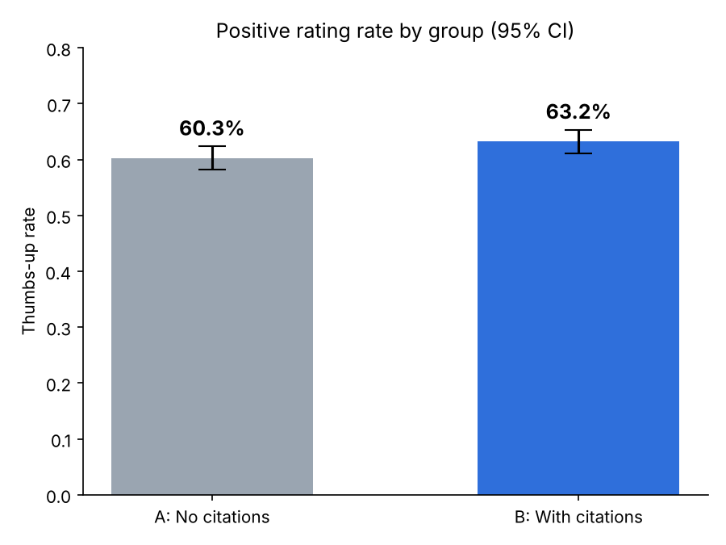

# Results

| Metric | A (Control) | B (Treatment) |
|---|---|---|
| Users | 2,150 | 2,053 |
| Thumbs-up | 1,296 | 1,298 |
| Thumbs-up rate | 60.28% | 63.22% |
| Mean latency (ms) | 1797 | 1852 |

- Required sample per group: **1,471** over **14 days**
- SRM check: p = 0.135 -> OK
- Absolute difference: **+2.95%** (95% CI: +0.01% to +5.88%)
- Relative lift: **+4.9%**
- Z = 1.96, p-value = **0.04956**
- Guardrail (latency): +3.1% (limit +10%) -> PASS

**Decision:** Launch (gradual rollout): citations significantly increase positive ratings without hurting latency.

> Caution: the observed lift is below the MDE (+5 pts) and the CI lower bound is close to zero. Prefer a gradual rollout or a larger re-test.

- Data quality: missing=0, duplicates=0, users in both groups=0

